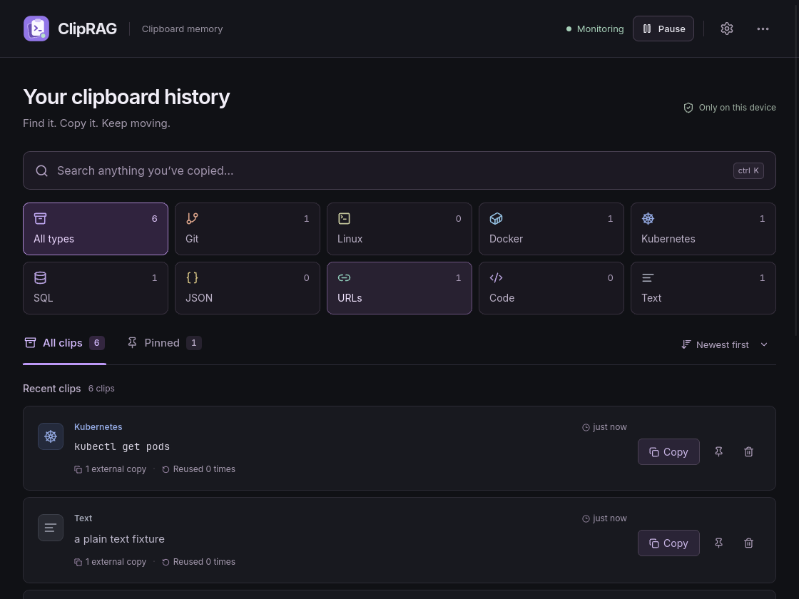
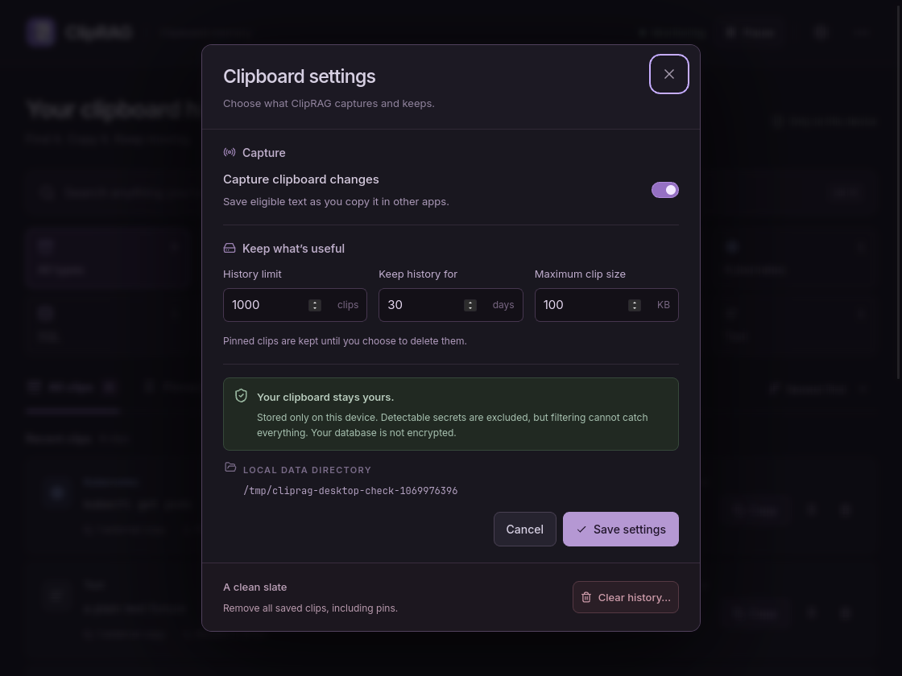
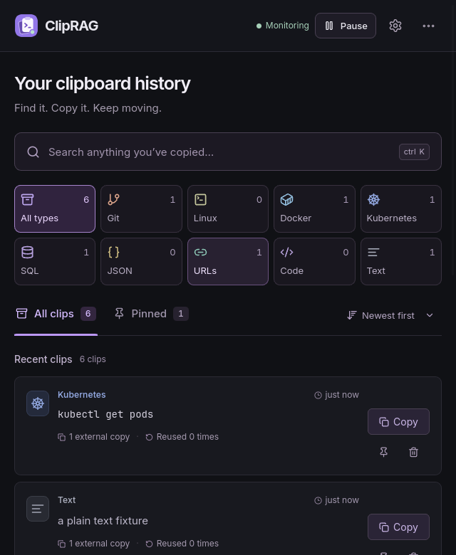

# ClipRAG

**Your developer clipboard memory.**

A local Linux clipboard manager for commands, snippets, links and text.
Find what you copied, pin useful clips, and copy them again when you need them.
No account, cloud service or AI required.



## Features

- **Find clips quickly:** search, clickable type cards, All clips and Pinned views.
- **Reuse exact text:** preserve formatting, expand long clips, and copy in one click.
- **Stay organized:** automatic categories, usage counts and newest/most-used sorting.
- **Keep control:** pause capture, set history limits, and clear saved clips.

Supports **GNOME 50 on Wayland** and **X11**. Other Wayland desktops, macOS and
Windows are not supported yet.

## Install on Ubuntu

For **Ubuntu 26.04 · AMD64 (64-bit Intel/AMD)**. No Go or Node.js installation needed.

[**Download ClipRAG (.deb)**](https://github.com/cric2000/clip-rag/releases/latest/download/cliprag.deb)

After downloading, open a terminal in the download folder and install:

```bash
sudo apt install ./cliprag.deb
```

### GNOME Wayland: enable the clipboard bridge once

Skip this step on X11. **Save your work, log out of Ubuntu, and log back in**
so GNOME discovers the bundled extension. Then enable it:

```bash
gnome-extensions enable cliprag@cliprag.local
```

Locking the screen or restarting ClipRAG is not enough.

Open **ClipRAG** from Ubuntu’s application launcher, or run:

```bash
cliprag
```

<details>
<summary>Build and run from source instead</summary>

Requires **Go 1.26.8+**, **Node.js 24+** and npm. From the project root:

```bash
sudo apt-get install -y build-essential pkg-config libgtk-4-dev libwebkitgtk-6.0-dev
npm ci --prefix frontend
npm run build --prefix frontend
mkdir -p bin
go build -tags production -trimpath -buildvcs=false -o bin/cliprag ./cmd/cliprag
```

On GNOME Wayland, install the bridge, then complete the logout/login step above:

```bash
./scripts/install-extension.sh
```

Start the source build with `./bin/cliprag`. Optionally add its launcher and icon
with `python3 scripts/install-desktop.py`.

</details>

## Using ClipRAG

Copy text in any app; new clips appear automatically while monitoring is active.

| Action | How |
| --- | --- |
| Search | Press **Ctrl+K**; **Esc** clears the search |
| Filter by type | Click a category card; click it again or choose **All types** to reset |
| Keep a clip | Click its pin icon, then find it in **Pinned** |
| Reuse a clip | Click **Copy**, then paste in your other app |
| Pause or configure capture | Use **Pause** in the header or open **Settings** |
| Quit | Open **⋯ → Quit ClipRAG** |

Search, category and Pinned filters work together. **External copies** counts copies
made in other apps; **Reused** counts copies made from ClipRAG.
Closing the window keeps capture running. Open ClipRAG again to bring it back.

If **Bridge unavailable** appears on GNOME, complete the clipboard bridge setup above.
To check the extension, run `gnome-extensions info cliprag@cliprag.local`.

## Storage and privacy

History stays on your device in `~/.local/share/cliprag/history.db`
(or `$XDG_DATA_HOME/cliprag/history.db`). Settings shows the exact directory.

Defaults are **1,000 unpinned clips**, **30 days** and **100 KB per clip**.
Pinned clips survive automatic cleanup; **Clear history** also removes pins after confirmation.

The database is **not encrypted**. Common secrets are filtered, but detection is
not perfect—pause capture before copying sensitive information.

<details>
<summary>More screenshots: settings and compact layout</summary>

### Settings



### Compact window



Screenshots use sample clipboard content from the native app’s isolated test run.

</details>

<details>
<summary>Development and checks</summary>

Built with Go, Wails 3, SQLite, React and TypeScript. Fonts are bundled for offline use.

```bash
go test ./...
npm test --prefix frontend
npm run lint --prefix frontend
```

Native UI checks require `xvfb`, `xclip` and `dbus-x11`:

```bash
sudo apt-get install -y xvfb xclip dbus-x11
./scripts/test-desktop.sh
```

See [GNOME bridge details](integrations/gnome-shell/README.md),
[build tasks](Taskfile.yml) and [third-party licenses](packaging/linux/THIRD_PARTY_NOTICES.txt).

</details>
