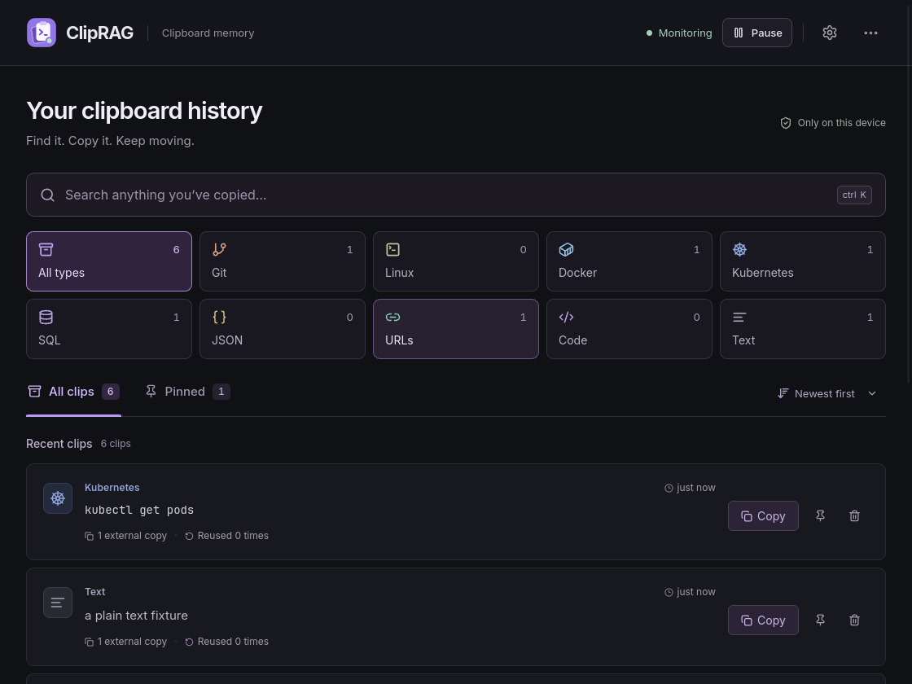
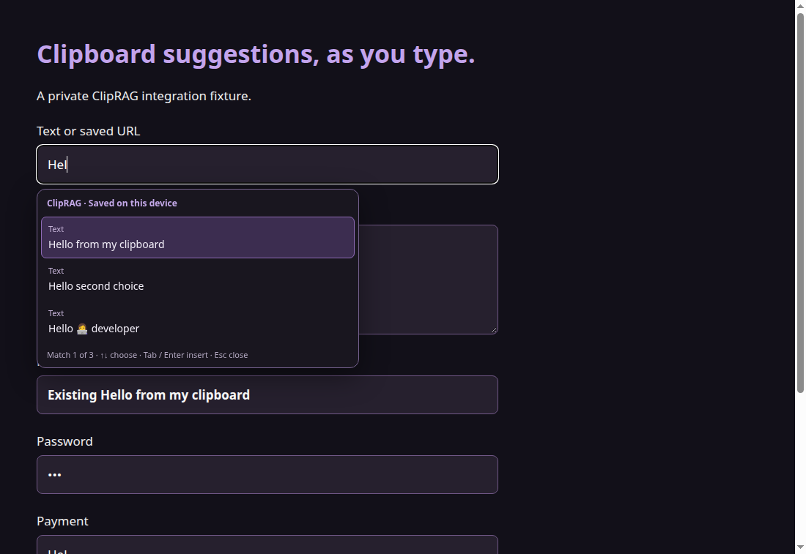
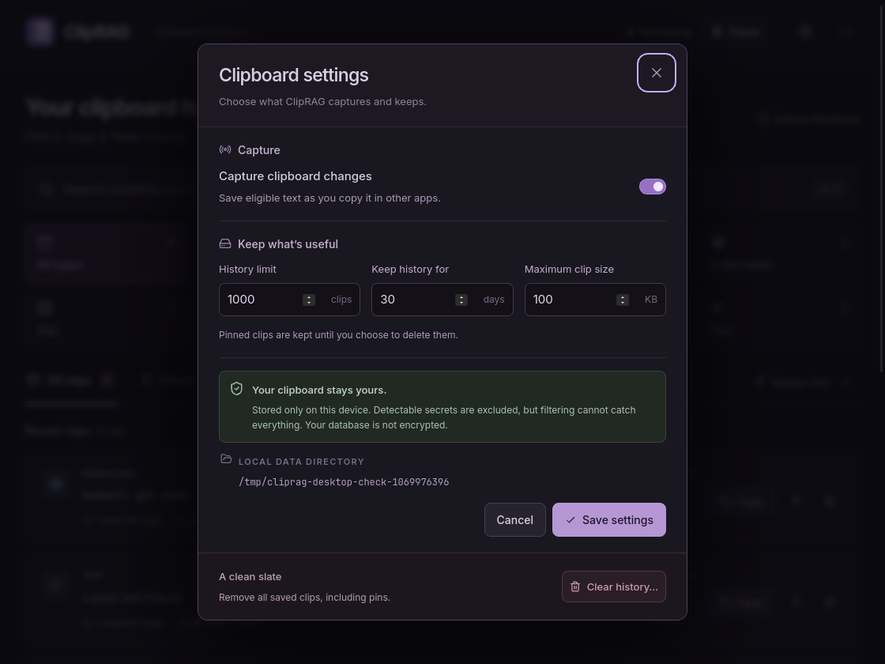
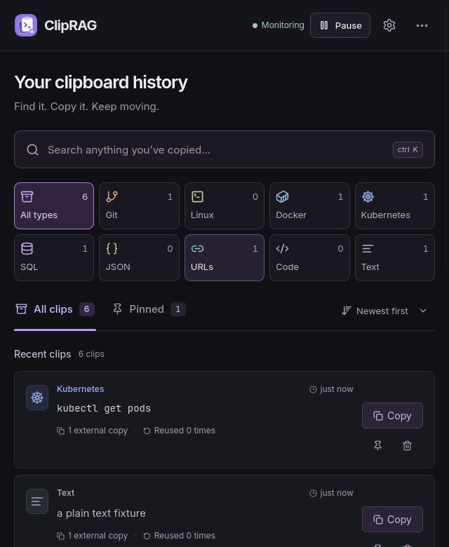

# ClipRAG

**Your developer clipboard memory.**

A local Linux clipboard manager for commands, snippets, links and text.
Find what you copied, pin useful clips, and copy them again when you need them.
No account, cloud service or AI required.



## Features

- **Find clips quickly:** search, clickable type cards, All clips and Pinned views.
- **Reuse exact text:** preserve formatting, expand long clips, and copy in one click.
- **Stay organized:** automatic categories, usage counts and newest/most-used sorting.
- **Complete as you type:** optional Bash/Zsh suggestions from saved commands, with local acceptance counts.
- **Reuse text in your browser:** optional Chrome-family autocomplete for URLs, prose and snippets (v0.3.0+).
- **Keep control:** pause capture, set history limits, and clear saved clips.

Supports **GNOME 50 on Wayland** and **X11**. Other Wayland desktops, macOS and
Windows are not supported yet.

## Install on Ubuntu

For **Ubuntu 26.04 · AMD64 (64-bit Intel/AMD)**. No Go or Node.js installation needed.

[**Download ClipRAG (.deb)**](https://github.com/cric2000/clip-rag/releases/latest/download/cliprag.deb)

Browser autocomplete requires **v0.3.0+**; the v0.2.0 release includes terminal autocomplete only.

After downloading, open a terminal in the download folder and install:

```bash
sudo apt install ./cliprag.deb
```

### GNOME Wayland: enable the clipboard bridge once

Skip this step on X11. **Save your work, log out of Ubuntu, and log back in**
so GNOME discovers the bundled extension. Then enable it:

```bash
gnome-extensions enable cliprag@cliprag.local
```

Locking the screen or restarting ClipRAG is not enough.

Open **ClipRAG** from Ubuntu’s application launcher, or run:

```bash
cliprag
```

<details>
<summary>Build and run from source instead</summary>

Requires **Go 1.26.8+**, **Node.js 24+**, npm and Python 3. From the project root:

```bash
sudo apt-get install -y build-essential pkg-config libgtk-4-dev libwebkitgtk-6.0-dev
npm ci --prefix frontend
npm run build --prefix frontend
mkdir -p bin
go build -tags production -trimpath -buildvcs=false -o bin/cliprag ./cmd/cliprag
go build -trimpath -buildvcs=false -o bin/cliprag-shell ./cmd/cliprag-shell
go build -trimpath -buildvcs=false -o bin/cliprag-browser ./cmd/cliprag-browser
python3 scripts/build-browser.py
```

On GNOME Wayland, install the bridge, then complete the logout/login step above:

```bash
./scripts/install-extension.sh
```

Start the source build with `./bin/cliprag`. Optionally add its launcher and icon
with `python3 scripts/install-desktop.py`.

</details>

## Using ClipRAG

Copy text in any app; new clips appear automatically while monitoring is active.

| Action | How |
| --- | --- |
| Search | Press **Ctrl+K**; **Esc** clears the search |
| Filter by type | Click a category card; click it again or choose **All types** to reset |
| Keep a clip | Click its pin icon, then find it in **Pinned** |
| Reuse a clip | Click **Copy**, then paste in your other app |
| Pause or configure capture | Use **Pause** in the header or open **Settings** |
| Quit | Open **⋯ → Quit ClipRAG** |

Search, category and Pinned filters work together. **External copies** counts copies
made in other apps; **Reused** counts copies made from ClipRAG. **Autocomplete uses**
appears after a clip is accepted from terminal or browser suggestions. It counts acceptance,
not execution, and stays on your device.
Closing the window keeps capture running. Open ClipRAG again to bring it back.

If **Bridge unavailable** appears on GNOME, complete the clipboard bridge setup above.
To check the extension, run `gnome-extensions info cliprag@cliprag.local`.

## Terminal autocomplete

Included in **v0.2.0+**. Open ClipRAG once after upgrading, then enable it for your shell:

```bash
cliprag-shell install bash
# Zsh users: cliprag-shell install zsh
```

For a source build, use `./bin/cliprag-shell` instead. Open a new terminal after setup.

1. Copy a command such as `git checkout main` while ClipRAG is monitoring.
2. At your Bash/Zsh prompt, type at least three characters, such as `git ch`.
3. A matching command appears automatically as **faded text**.
4. Press **Right Arrow** to accept it or **Esc** to dismiss it. **Enter runs only
   what you have typed or accepted**.

Use **Alt+/** for more matches; arrows or Tab select, Enter inserts, Esc cancels.
Normal Tab completion stays intact. Suggestions work at the shell prompt, including
vi insert mode, with the cursor at the end of the line. Matching uses an exact,
case-sensitive prefix and works with ClipRAG closed.

**Command clips only:** single-line Git, Linux, Docker, Kubernetes and common
developer commands such as `go test` or `npm run dev`. Standalone URLs, ordinary
text, SQL, JSON, multiline clips and detected secrets are excluded from suggestions.
They remain available in clipboard history if eligible for capture.

**Compatibility:** works with supported Bash/Zsh line editors in conventional
terminals. **Warp’s native input editor is unsupported.** App editors and programs
running inside the terminal are outside this integration. Browser fields use the
separate extension below.

To remove it, run `cliprag-shell uninstall bash` (or `zsh`) and open a new terminal.
See [shell setup and controls](integrations/shell/README.md) for current-session
activation and pausing.

## Browser autocomplete (v0.3.0+)

The v0.2.0 `.deb` does not include this feature. Use a v0.3.0+ package or the
source build above. Open ClipRAG once and copy some text before testing suggestions.

Register the bridge and use the extension folder for your installation:

| Installation | Setup command | Extension folder |
| --- | --- | --- |
| v0.3.0+ `.deb` | `cliprag-browser install chrome` | `/usr/share/cliprag/browser-extension` |
| Source build (from project root) | `./bin/cliprag-browser install chrome` | `bin/cliprag-browser-extension` |

1. Run the setup command above as your normal user, without `sudo`. Replace
   `chrome` with `chromium`, `brave`, or `edge` for those browsers.
2. Open `chrome://extensions`, enable **Developer mode**, choose **Load unpacked**,
   and select the extension folder above.
3. Open a website, choose **Enable on this website** in ClipRAG's toolbar popup,
   and approve access. Enable each website once; your choice is remembered.
4. Type at least three characters from the beginning of a saved clip for automatic
   matches. **Tab/Enter** inserts; **Esc** closes.

All saved text categories are supported: URLs, normal text, commands, code,
SQL, JSON and multiline clips in multiline fields. Password/payment fields
are excluded. Matching stays local, and accepting does not submit the form.
For saved URLs in the address bar, type **`clip` then Space**, followed by a domain
such as `github.com` (`https://` is optional). Enter opens the first match.



See [browser setup and controls](integrations/browser/README.md) for installed-package
paths, custom data locations, compatibility and removal.
After updating the package or rebuilding, reload the extension on its Extensions
card and refresh older website tabs once. Snap/Flatpak browser packages may not
support the native bridge; use a native browser package for this version.

## Storage and privacy

History stays on your device in `~/.local/share/cliprag/history.db`
(or `$XDG_DATA_HOME/cliprag/history.db`). Settings shows the exact directory.

Defaults are **1,000 unpinned clips**, **30 days** and **100 KB per clip**.
Pinned clips survive automatic cleanup; **Clear history** also removes pins after confirmation.

The database is **not encrypted**. Common secrets are filtered, but detection is
not perfect—pause capture before copying sensitive information.

<details>
<summary>More screenshots: settings and compact layout</summary>

### Settings



### Compact window



Screenshots use sample clipboard content from isolated app and browser tests.

</details>

<details>
<summary>Development and checks</summary>

Built with Go, Wails 3, SQLite, React and TypeScript. Fonts are bundled for offline use.

```bash
go test ./...
npm test --prefix frontend
npm run lint --prefix frontend
```

Native UI checks require `xvfb`, `xclip` and `dbus-x11`:

```bash
sudo apt-get install -y xvfb xclip dbus-x11
./scripts/test-desktop.sh
```

Terminal checks also require Zsh:

```bash
sudo apt-get install -y zsh
./scripts/test-shell.sh
```

Browser checks use an installed native Google Chrome and a separate test profile:

```bash
./scripts/test-browser.sh
```

See [GNOME bridge details](integrations/gnome-shell/README.md),
[build tasks](Taskfile.yml) and [third-party licenses](packaging/linux/THIRD_PARTY_NOTICES.txt).

</details>
